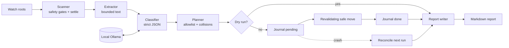

# Sloth Valet

A slow, private file valet for a messy downloads folder.

Sloth Valet waits until files have settled, asks a small local open-weight model
(through Ollama) for a category and a clean filename, and moves the files into a tidy
destination tree. It runs offline, journals every move, writes a morning report, and
prefers leaving a file alone over guessing.

Built for **Hacktoberfest 2026: Slow and Steady** — open-weight AI that rewards
patience, privacy, and a recoverable filesystem.

## Status

Version `0.1.0`. The full pipeline is implemented: validated configuration, read-only
scanning, bounded extraction, local classification, planning, journaled moves, review
routing, crash reconciliation, undo, Markdown reports, optional desktop notifications,
a systemd user timer, and a model-comparison benchmark harness.

The default test suite uses mocked HTTP and fake classifiers. It does not need a
network connection, a running Ollama, a real systemd session, or a notification
daemon.

## Why this shape

- **Offline and private:** the only network destination is the Ollama host in your
  config, normally `http://localhost:11434`. There is no telemetry or hosted API.
- **Free to run:** plain Python and a local open-weight model.
- **Swappable:** the model name is never assumed. You supply it in config or with
  `valet bench --models`.
- **Safe unattended:** dry-run is the default; protected paths and ignore globs are
  checked before extraction or any model call; symlinks are never followed; every
  move is journaled and undoable.
- **Honest about small models:** a tiny model will misclassify some files. The
  benchmark, `_review/` folder, reports, and undo are part of the design, not an
  afterthought.

## Requirements

- Linux (the scheduler targets systemd user units).
- [uv](https://docs.astral.sh/uv/) for installation and development.
- Python 3.12, normally managed by uv.
- [Ollama](https://ollama.com/) running locally, plus at least one model you have
  pulled yourself.
- Optional: `notify-send` for desktop notifications; a systemd user session for the
  timer.

Sloth Valet does not download a model or choose one for you.

## Install

From a clone:

```sh
git clone <repository-url> sloth-valet
cd sloth-valet
./install.sh
```

`install.sh` runs `uv tool install`, so `valet` is installed in its own environment
under `~/.local/bin`. It does not use sudo and does not install or start a system
service. If `valet` is not on your `PATH`, the script prints the export line to add.

For development instead:

```sh
uv sync
uv run valet --version
```

## Quick start

```sh
# Choose a model you already have. Do not copy a model name you have not pulled.
ollama list

valet config init
$EDITOR ~/.config/sloth-valet/valet.toml
```

Set at least:

- `[model].name` to an installed Ollama model name;
- each `[[watch]].path` to the folder to tidy;
- each `[[watch]].destination_root` to a folder outside every watch root;
- protected paths and ignore globs appropriate for your machine.

Then preview before applying:

```sh
valet scan                 # read-only candidate list
valet run                  # dry-run plan, no moves
valet run --apply          # journal and move
valet report --last        # Markdown result of the most recent run
valet undo --last          # restore the most recent applied moves, if still valid
```

The example config is [`valet.example.toml`](valet.example.toml). `valet config init`
copies it without overwriting an existing file. `valet config show` prints the fully
resolved config as JSON.

## What a run actually does

1. **Scan** each watch root for settled regular files. Protected paths, ignore globs,
   partial-download suffixes, symlinks, size limits, and a delayed stability check are
   all applied before content is opened.
2. **Extract** a bounded amount of text from supported files. Images and unknown
   binaries contribute metadata only.
3. **Classify** through the local Ollama host. The model must return JSON matching the
   Pydantic schema; the category must be in the configured allowlist; the filename and
   subfolder are sanitized. Low confidence, timeouts, invalid JSON, or an unavailable
   model never become guesses.
4. **Plan** a collision-free destination, or route a failure to `_review/` when
   `review_on_failure = true`.
5. **Apply** only when `--apply` or `dry_run = false`. The applier revalidates the
   source fingerprint and destination immediately before moving, writes a `pending`
   journal row, moves safely, and marks it `done`.
6. **Report** the summary and details as escaped Markdown, then optionally send a
   count-only desktop notification.

A second applied run over the same tree is a no-op. If a crash leaves a pending
journal row, the next run reconciles it without deleting ambiguous files.

## Reports and undo

Reports are written under `general.reports_dir` and their paths are stored in the
SQLite journal at `<reports_dir parent>/journal.sqlite3`.

```sh
valet report --last
valet report --run <run-id>
```

Set `notify = true` for a short `notify-send` message containing counts only. The
notification is best-effort and never changes a file outcome.

`valet undo --last` (or `undo --run <run-id>`) restores only `done` rows where the
destination still exists, its SHA-256 matches the journal, both paths remain inside
the configured roots, and the original path is free. Refusals are printed and leave
both paths untouched.

## Daily scheduling

After a successful dry run, install a persistent systemd user timer:

```sh
valet install-timer --time 03:00
valet status
valet uninstall-timer
```

The units live in `$XDG_CONFIG_HOME/systemd/user` (default
`~/.config/systemd/user`). The service runs
`valet --config <absolute-config> run --apply` with low CPU and I/O priority; the
timer is persistent, so a missed run starts after boot. `--valet PATH` overrides the
executable embedded in the unit. `install-timer` runs `systemctl --user
daemon-reload` and `enable --now`; if that fails, the unit files remain and the
command prints how to finish. `valet status` is read-only and never invokes
`systemctl`.

**The timer applies moves.** Test `valet run` as a dry run first.

## Benchmark

The benchmark uses 50 committed fixture labels covering the default categories and a
mix of text, PDF, DOCX, CSV, JSON, code, archive, image, installer, and media files:

```sh
uv run python scripts/make_fixtures.py
uv run valet bench --models <model-one>,<model-two>
```

Generated fixtures are ignored; [`bench/labels.json`](bench/labels.json) is committed.
The harness disables fast paths, extracts every fixture, and calls the same classifier
used by `valet run`. It records:

- valid-JSON rate;
- category accuracy against the labels;
- mean confidence;
- mean and p95 latency;
- failure counts;
- optional best-effort peak Ollama RSS from Linux `/proc` with `--measure-memory`.

Each run writes a timestamped JSON file and Markdown summary under `bench/results/`;
existing results are never overwritten. The benchmark never journals, plans, moves,
or deletes files. Model names are always CLI arguments and are never hardcoded.

Real models differ substantially on this kind of task. Do not hand-edit or invent
results. Pull at least two models, run the benchmark on the machine you actually use,
review the files, and commit only authentic output. The repository intentionally does
not ship made-up model names or numbers.

An authentic CPU-only run is committed in
[`bench/results/`](bench/results/README.md). On the 50 fixtures:

| Model | Valid JSON | Category accuracy | Mean latency | Peak RSS |
| --- | ---: | ---: | ---: | ---: |
| `qwen2.5:0.5b` | 100.0% | 12.0% | 935.5 ms | 660.6 MiB |
| `llama3.2:1b` | 100.0% | 80.0% | 1489.5 ms | 788.5 MiB |

This is one run on one CPU-only machine, not an endorsement. The gap is the point:
small models can produce perfectly valid JSON and still choose the wrong category.

## Demo

For a safe, self-contained workflow that never touches a real Downloads folder:

```sh
./scripts/demo.sh <model-name>
```

The script generates fixtures in a fresh temporary directory, creates a config, then
runs scan, dry-run, apply, report, a second apply, and undo. It leaves the demo
directory in place for inspection and never deletes a user file.

A terminal recording of the verified `llama3.2:1b` run is committed at
[`docs/demo.cast`](docs/demo.cast):

```sh
uvx --from asciinema asciinema play docs/demo.cast
```

## Configuration

The CLI reads `$SLOTH_VALET_CONFIG` when set, otherwise
`~/.config/sloth-valet/valet.toml`. `--config PATH` overrides both.

Relative paths resolve against the config file's directory; `~` expands. A
destination root inside a watch root is rejected, and `reports_dir` may not be inside
a watch root, so the pipeline can never scan its own journal or reports.

Key safety settings:

```toml
[general]
dry_run = true
settle_minutes = 30
review_folder = "_review"
review_on_failure = true
notify = false
reports_dir = "~/.local/share/sloth-valet/reports"

[model]
host = "http://localhost:11434"
name = "set-me-after-checking-ollama-list"
temperature = 0
timeout_s = 60
min_confidence = 0.7
text_chars = 1500
```

`fast_path` maps obvious extensions such as `.deb` or `.iso` to allowed categories
without a model call. Configured fast-path categories are validated against the
allowlist. The model name has no default; read it from `ollama list`.

## How it works



The authoritative stage and trust-boundary description is in
[`docs/ARCHITECTURE.md`](docs/ARCHITECTURE.md). The detailed invariants are in
[`docs/SAFETY.md`](docs/SAFETY.md).

## Limits and failure behavior

- A small model can choose a wrong **allowlisted** category, even with prompt-injection
  defenses. Content fencing reduces instruction attacks; it does not make the model
  correct. Benchmark before trusting a model and keep `_review/` enabled.
- Confidence is the model's own number, not a calibrated probability.
- Settlement is based on mtime, size, device, and inode; a program that writes slowly
  without changing those can still fool it.
- Hash checks protect move integrity. They do not protect against a privileged local
  attacker who can modify both the file and the journal.
- Reports and the journal are local files and are not encrypted.
- The benchmark uses synthetic fixtures. It measures behavior on a reproducible sample,
  not your entire real folder.
- The optional memory figure is a best-effort sum of Linux `VmHWM` for the Ollama
  server and its Ollama-spawned runner processes, not a per-model allocator
  measurement.

Every classifier failure is explicit. If the model is unavailable, slow, malformed, or
uncertain, the file stays put or goes to review.

## Privacy

There are no analytics, no telemetry, and no calls to a hosted model. The only HTTP
module is [`ollama.py`](src/sloth_valet/ollama.py), and an architectural test enforces
that boundary. If you change `[model].host` to a remote URL, file text is sent there;
keep it on localhost for a fully local setup.

## Development

```sh
uv sync
uv run ruff check .
uv run mypy src tests
uv run pytest -q
```

The live Ollama test is opt-in and never hardcodes a model:

```sh
SLOTH_VALET_LIVE=1 SLOTH_VALET_TEST_MODEL="$(ollama list | awk 'NR==2 {print $1}')" \
  uv run pytest -q tests/test_classifier.py -m live
```

Run `uv run python scripts/make_fixtures.py` before a benchmark. The release checks
are also run by [`.github/workflows/ci.yml`](.github/workflows/ci.yml).

## Project layout

```text
src/sloth_valet/   config, scanner, extraction, classifier, planner, journal,
                   applier, runner, report, systemd, fixtures, benchmark, CLI
tests/             unit, safety, end-to-end, CLI, benchmark, and boundary tests
bench/             committed labels and results; generated fixtures are ignored
docs/              architecture, safety, and the terminal demo recording
scripts/           deterministic fixture generator and safe end-to-end demo
```

## Uninstall

```sh
valet uninstall-timer
uv tool uninstall sloth-valet
```

That removes only the installed tool and the two Sloth Valet systemd units. It does
not delete your sorted files, watch folders, reports, journal, or configuration; remove
those yourself only after reviewing them.

## Contributing

See [`CONTRIBUTING.md`](CONTRIBUTING.md). Please preserve the safety invariants and
never invent model names or benchmark results.

## Changelog

See [`CHANGELOG.md`](CHANGELOG.md).

## License

Sloth Valet is released under the [MIT License](LICENSE).
